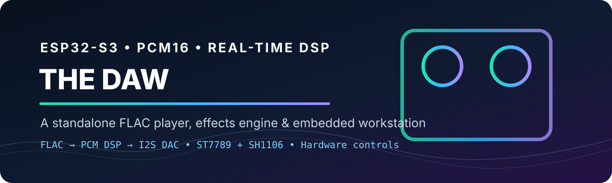

# ESP32-S3 DJ Audio Console / DAW

<p align="center"></p>

[](https://github.com/anksax/DAW/actions/workflows/ci.yml) [](LICENSE)

A standalone FLAC player and DJ-style audio console for the **ESP32-S3 N16R8**, with physical controls, an ST7789 main display, an SH1106 OLED, real PCM effects, EQ, artist metadata and a playback timeline.

**Active development:** USB/Serial Monitor disconnection still causes distorted output on the user's hardware. Disabling diagnostic writes has not resolved the reported behavior. Do not treat V6 as a stable audio release.

## Quick start

1. Install Arduino-ESP32 **3.3.12**, AudioTools, codec-libfoxenflac, Adafruit GFX, Adafruit ST7735 and ST7789 Library, and U8g2.
2. Open **[DJ_Audio_Console_V6/DJ_Audio_Console_V6.ino](DJ_Audio_Console_V6/DJ_Audio_Console_V6.ino)**. Keep **all files** in that sketch folder together, including lyric/browser/cover headers and the bundled JPEG C decoder. The root V4 sketch is retained as a legacy reference.
3. Use ESP32S3 Dev Module, 16 MB flash, OPI PSRAM and the settings in [Board setup](docs/BOARD_SETUP.md). Wiring is in [Hardware](docs/HARDWARE.md).
4. Put mono/stereo `.flac` files on microSD; nested folders are scanned. Source 24-bit FLAC is decoded into **16-bit PCM** for DSP/I2S. This is not a 24-bit output pipeline.
5. Compile and upload. Joystick click starts the selected track; playback does not start automatically at boot. At EOF, playback advances automatically in sequence or shuffle mode.
6. Hold the joystick to open settings and confirm the build label **V6 R3 20261014 LOG:OFF**. This identifies the new firmware; a failed build/upload can leave the previous build installed.
7. Serial diagnostics are **off by default**. For a capture, set `DAW_SERIAL_DIAGNOSTICS` to `1` in `SerialDiagnostics.h` and rebuild; use 115200 baud. Return it to `0` for normal use.

For Windows, extract the complete project first. A simple path such as `C:\Arduino\DJ_Audio_Console_V6` avoids command-parser issues. See [Troubleshooting](docs/TROUBLESHOOTING.md).

## Controls

| Control | Player / FX action |
|---|---|
| Encoder 1 rotate | Selected FX strength, 0–25; reversed rotation retained |
| Encoder 1 click | Next effect and return to FX page |
| Encoder 1 hold | Selected effect ON/OFF |
| Encoder 2 click | Enter highlighted folder / play highlighted song |
| Encoder 2 hold | Shuffle / sequential |
| Encoder 2 rotate | Browse current artist/album/song level |
| Joystick up/down | Browse current level; hold vertically to repeat after 450 ms |
| Joystick right | Enter highlighted folder / play highlighted song |
| Joystick left | Return song → album → album artist |
| Joystick click | Play/pause/resume; exit settings when settings are open |
| Joystick hold | Open/close main-screen EQ/OLED settings |
| Joystick up/down in settings | Select bass, mid, treble or OLED view |
| Joystick left/right in settings | Decrease/increase selected setting |
| Fader | Master volume, 0–25 |

Encoder 2 hold toggles shuffle even in settings; rotation/click do not edit settings. OLED view cycles FX/spectrum/lyrics using joystick left/right on its settings row. FX and spectrum appear only on the OLED. Title, artist, album, timeline, library, volume and settings appear on the TFT. The adjustable brightness setting is removed; TFT BL is fixed HIGH and OLED contrast is fixed full.

## Audio path and effects

FLAC from SD → Foxen PCM16 decoder → PCM visualization tap → per-channel DSP/EQ → master gain → I2S DAC.

| Effect | Processing |
|---|---|
| Filter | Low/high-pass filtering |
| Echo | Feedback delay |
| Fuzz / distortion | Driven nonlinear processing / clipping |
| Tremolo | Amplitude modulation |
| Compressor | Dynamic-range processing |
| Chorus | Modulated fractional delay |
| Bitcrusher | Reduced resolution / sample holding |
| SLOW | I2S clock rate, 100–50% speed with pitch reduction |
| Phaser | Modulated all-pass stages |
| Flanger | Short modulated delay with feedback |
| Vocoder | Six-band track-envelope modulation of a local synth carrier |
| Ring modulation | Multiplication by an oscillator |
| Reverb | Four damped comb delays and two all-pass diffusers; saved 0–25 strength |

Enable up to **three PCM effects**, plus SLOW. Only per-effect enable toggles exist; there is no separate global enable control. Each effect keeps its own 0–25 strength when browsing effects. Internal character presets replace separate parameter/mix controls. Bass/mid/treble EQ is ±12 dB.

FX strength, enabled stages and EQ are stored in NVS after changes settle and playback is paused/stopped. Pause and wait at least two seconds before removing power if you want edits saved. Legacy settings are migrated. Volume, shuffle and track selection are not persisted.

SLOW changes wait for **250 ms without another adjustment**, then update the output clock only if the requested rate differs. This reduces repeated reconfiguration; a final clock transition can still be audible. SLOW is not pitch-preserving time stretching. Vocoder uses a four-harmonic carrier, lower gain, a soft clipping knee and approximately 20 ms strength/enable ramps. Hardware sound quality remains under test.

## Metadata, timeline and visualization

- Bounded native FLAC Vorbis-comment parsing for TITLE, ARTIST, ALBUM and ALBUMARTIST, with a small cache for visible/playing tracks.
- Missing artist tags display as unknown. [MusicBrainz Picard tagging](docs/MUSICBRAINZ_TAGGING.md) happens on a PC; the ESP32 does not query MusicBrainz or extract vocal stems.
- Timeline comes from decoded source-frame progress and FLAC total samples. It tracks source position under SLOW. Seeking/scrubbing is not implemented.
- Eight FFT bands use real decoded PCM, with smoothing and peaks. Master gain is applied after DSP.

## Build and validation

The saved [native USB](board-fqbn.txt) and [UART](board-fqbn-uart.txt) profiles select N16R8 board options. CLI defaults are in `sketch.yaml`; they do not force Arduino IDE to remember the board/port.

```powershell
.\build_upload.ps1 -Action list
.\build_upload.ps1 -Action build
.\build_upload.ps1 -Action upload -Port COM7
```

Use your actual port, and `-Uart` for the USB-to-UART profile. Scripts require Arduino CLI and installed dependencies; they compile before uploading and never guess a port. PowerShell execution and physical upload have not been verified here.

```bash
bash validation/run_checks.sh
```

Host checks regenerate DSP/control tests from the sketch and run address/undefined-behavior sanitizers. They cover PCM bounds, bypass, all effects, vocoder stress/silence, rapid strength changes, controls, settings migration, SLOW coalescing, timeline, FFT, partial writes, metadata fuzzing and the optional diagnostic stream. **Host API models are not ESP32 compilation, timing measurements or listening tests.** CI builds V6 with the saved board profile and pinned core/AudioTools/Foxen versions.

## Known limits and next checks

- Closing Arduino IDE/Serial Monitor still produces distorted output on the user's board. The root cause is unconfirmed. Test standalone USB power and distinguish a reboot from an audio stall; see [Troubleshooting](docs/TROUBLESHOOTING.md).
- Hardware confirmation is needed for joystick navigation, fixed TFT backlight, rapid SLOW/vocoder changes, long playback, sample-rate changes and USB disconnects.
- TFT and SD share SPI. UI drawing uses a 153,600-byte PSRAM canvas; only one 8-row stripe is transferred per loop, at 16 MHz. The standard Arduino SPIClass transaction mutex serializes TFT and SD traffic; transfers do not acquire the broader decoder/I2S audio mutex. A five-second repaint restores retained pixels without clearing/resetting the panel. This is recovery for lost contents, not proof of a physical SPI/reset/power fix.
- New tag reads are deferred while playing. Previously cached tags remain visible; uncached artists show a pause-to-read hint until playback pauses/stops.
- No dual-deck mixing, recording, network metadata lookup, MP3, MIDI or pitch-preserving time stretching is implemented. Two-song mixing requires separate decoder/buffer paths and a mixer; it is not enabled by stacking effects.

See [V6 changes](docs/CHANGELOG_V6.md), [development/testing](docs/DEVELOPMENT.md), [contributing](CONTRIBUTING.md) and [license](LICENSE).


### Playback/UI scheduling revision (13 October)

The joystick and encoders are sampled first in the loop. Expensive TFT composition runs in PSRAM without acquiring the audio lock; short stripe transfers use the SPIClass transaction mutex instead of waiting behind an entire decoder/I2S copy. Joystick vertical hold repeats every 140 ms after an initial 450 ms; horizontal enter/back actions stay one-shot, and exiting settings still requires neutral. Encoder 2 rotation browses the library; click enters folders or plays the highlighted song, hold toggles shuffle, and OLED view is selected in settings. OPI PSRAM must be enabled; failed canvas allocation shows an OLED error and leaves audio usable. Physical timing and the random blank-panel symptom require board verification. These changes do not claim to fix the existing PC USB-disconnect distortion.


### Reverb, album and control update (R2)

Select REVERB in the FX list with E1 click, adjust strength with E1 rotation and enable it with E1 hold. It uses fixed internal-RAM delay lines, approximately 17.25 KiB per DSP instance (about 51.75 KiB for prototype/stereo clones), no sample-loop allocation, damping, stable feedback and diffusers. Delay lengths are capped at higher sample rates. Old 13-effect NVS records migrate into the 14-effect layout without losing strength settings; reverb starts disabled with strength 12.

E2 rotates through the current artist/album/song level, clicks to enter/select, and holds to toggle shuffle. OLED FX/spectrum/lyrics is selected in main settings. Joystick settings hold repeats after 350 ms at 100 ms intervals. Reverb retains the same three-PCM-stage cap and idle-save behavior as other FX.

The playing card shows the ALBUM tag when cached, otherwise the parent folder immediately. The library header also shows the selected song's album. Root-level tracks without tags show Album unknown. Names longer than the visible fields are truncated; title/artist/album share the existing small cache and new SD tag reads still wait until pause/stop.

The brightness setting and its saved NVS reads/writes are removed. The TFT backlight is driven HIGH and OLED contrast is fixed at 255. Old bright values are ignored without erasing other preferences.

Positive EQ boosts now include automatic preamp attenuation equal to the largest positive boost, preserving relative EQ shaping while reducing digital clipping. This can reduce apparent loudness and does not recover deliberately distorted FX or correct an overloaded analog output. If headphones connect directly to a PCM5102A, its line output is specified for loads down to 1 kOhm, so low-impedance headphones need a suitable headphone amplifier. Source: https://www.ti.com/lit/ds/symlink/pcm5102a.pdf. High-volume clarity with EQ flat/FX off remains a hardware listening check.


### R3: album hierarchy, lyrics and optional covers

The library now follows **album artist/album/song** folders and starts at album artists. Joystick left/right goes back/enters; E2 rotation/click also browses/selects. Folder focus remains unchanged when playback advances. Album names are larger and scroll, with dividers/headings when browsing album changes. Artist tags take precedence for song metadata; missing artist tags fall back to the album-artist folder.

Optional same-basename `.lrc` files add synchronized lyrics as the third OLED view. Folder `cover.jpg`/`folder.jpg` (also `.jpeg`) or embedded FLAC JPEG can add an aspect-fitted thumbnail. Missing/unsupported art leaves no placeholder and gives text its full width. These files load at stopped track transitions, not repeatedly while audio plays. Limits, offset convention, folder examples, memory and format details are in [Lyrics and albums](docs/LYRICS_AND_ALBUMS.md). The JPEG decoder is bundled with its [attribution](docs/THIRD_PARTY.md), so no new library install is required. Real SPI/audio/lyric timing still needs a board test.

The TFT header displays **THE DAW**.
